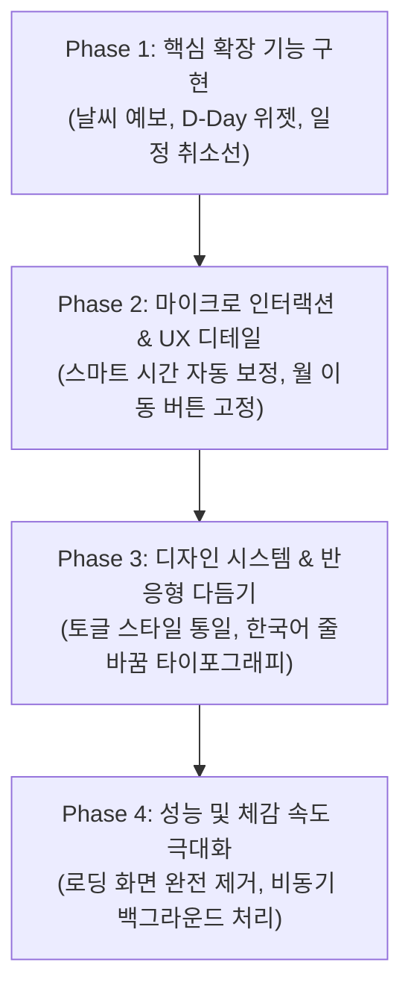

# 캘린더 서비스 "모아(MOA)" 개발기: AI와 함께 만든 실시간 공유 캘린더

> **"각자의 하루를, 우리의 시간으로."**  
> 링크 하나로 초대하고, 실시간으로 함께 쓰는 가볍고 빠른 공유 캘린더 서비스 **모아(Moa Calendar)**의 기획, 아키텍처, 그리고 실제 AI 페어 프로그래밍 프롬프트와 개발 이야기입니다.

---

## 1. 프로젝트 개요 및 기획 컨셉

### 1.1 왜 새로운 캘린더를 만들었는가?
기존의 구글 캘린더나 애플 캘린더는 훌륭하지만, 가족, 연인, 소규모 스터디/동아리 멤버들이 **"가장 부담 없이 즉시 일정을 공유"**하기에는 초기 진입 장벽(상대방 이메일 수집, 공유 권한 승인 절차 등)이 다소 높고 앱이 무겁게 느껴졌습니다.

**모아(Moa)의 핵심 목표:**
- **링크 하나로 즉시 참여**: 복잡한 승인 과정 없이 초대 링크 하나로 캘린더에 바로 참여
- **실시간 협업(Presence & Sync)**: 같은 캘린더를 보고 있는 사람들의 실시간 접속 상태와 일정 수정 내역이 SSE(Server-Sent Events)로 지연 없이 동기화
- **체감 로딩 제로(Zero-Latency UX)**: "서비스를 불러오고 있어요" 같은 무거운 로딩 스피너를 배제하고, 브라우저를 열자마자 즉시 달력이 뜨는 반응형 웹
- **생활 밀착형 기능의 기본 내장**: 시간대별 날씨 예보, 디데이(D-Day) 위젯, 한국 음력/윤달, 국경일, To-Do 및 취소선 일정 관리

### 1.2 기술 스택 및 아키텍처
| 영역 | 기술 스택 | 선정 이유 |
| --- | --- | --- |
| **Backend** | Node.js 24+, native fetch, native test runner | 별도의 대규모 프레임워크 없이 빠르고 가벼운 단일 프로세스 아키텍처 |
| **Database** | PostgreSQL, scrypt 해싱 | 데이터 무결성과 트랜잭션, 사용자 및 캘린더 권한 관리 |
| **Frontend** | Vanilla Modern JavaScript (ES Modules), Modern CSS | 무거운 번들러/SPA 프레임워크(React/Next.js) 없이 0ms에 가까운 빠른 파싱과 네이티브 렌더링 성능 확보 |
| **Realtime** | Server-Sent Events (SSE) | 웹소켓 대비 방화벽 친화적이며 단방향 실시간 이벤트 전송에 최적화 |
| **외부 연동** | Google Calendar REST API, Apple iCloud CalDAV (XML/iCal) | 외부 캘린더와의 양방향 동기화 및 마이그레이션 지원 |
| **인프라/운영** | PM2, Nginx Reverse Proxy, Cloudflare, Home/Edge Server (`pi-server`) | 비용 효율적이면서도 안정적인 자립형 서버 운영 환경 |

---

## 2. 개발 과정에서 실제로 사용한 프롬프트 (Prompt Archive)

AI와의 페어 프로그래밍을 진행하면서 기능 추가부터 마이크로 UX 개선, 그리고 성능 튜닝까지 점진적으로 발전시켜 나갔습니다. 실제로 사용했던 프롬프트 원문과 의도입니다.

---

### Phase 1: 기능 추가 및 외부 API 연동

#### 💬 프롬프트 1 (날씨 예보 및 설정)
> *"달력에 예상 날씨를 표시해줘 날짜 옆에 이모지로 표시해주고 비가 온다면 확률 표시도 해줘  
> 날씨 데이터는 어디서 가져 올 수 있지?  
> 사용자가 위치를 설정할 수 있게도 해줘 설정 페이지에서"*

- **구현 결과**: API 키 없이 고해상도 날씨를 제공하는 **Open-Meteo API**를 채택. 달력 날짜 셀에 날씨 이모지와 강수확률(%) 배지를 렌더링하고, 설정에서 시/군/구 위치를 직접 검색해 저장할 수 있는 지오코딩 기능을 구현했습니다.

#### 💬 프롬프트 2 (시간대별 날씨 팝업)
> *"날씨를 클릭하거나 터치하면  
> 시간대 별로 보여줄 수 있어?"*

- **구현 결과**: 날씨 배지 클릭 시 모달 다이얼로그(`<dialog>`)를 띄워 3시간 간격의 기온, 강수확률, 풍속, 하늘 상태를 시각화한 미니 타임라인을 추가했습니다.

#### 💬 프롬프트 3 (D-Day 위젯 및 순서 변경)
> *"dday 기능을 추가 하고 싶은데  
> 일정에 d-day 로 추가 하면  
> 달력 위에 d-day 위젯들을 보여주는거야  
> d-day 위젯은 순서를 변경할 수 있게 해주고  
> 위치는 왼쪽 월 이동 오른쪽 오늘, 일간, 주간, 월간 사이에 빈 공간에 위치시켜줘"*

- **구현 결과**: 일정 생성 시 `D-Day` 속성을 부여할 수 있도록 필드를 추가하고, 상단 툴바의 빈 공간에 남은 일수(`D-7`, `D+3`) 위젯 칩을 배치했습니다. 마우스 드래그 앤 드롭 및 터치로 사용자가 원하는 순서로 재배치할 수 있으며, 이 순서는 로컬에 즉시 영구 저장됩니다.

---

### Phase 2: 마이크로 인터랙션 & 스마트 UX

#### 💬 프롬프트 4 (일정 취소 체크 & 시작/종료 시간 자동 보정)
> *"일정 취소 체크 기능도 추가해줘  
> 그리고 시작 시간이 종료 시간보다 작다면  
> 시작 시간을 변경해도 종료 시간 조정하지 말아줘  
> 시작 시간과 종료 시간이 같거나 종료 시간이 작을 때만 +1 시간 해줘"*

- **구현 결과**:
  1. 일정 취소 여부를 체크하면 달력과 상세 목록에서 취소선(strikethrough)과 함께 은은한 톤으로 변환.
  2. 시작 시간을 바꿀 때 무조건 종료 시간을 +1시간 밀어버리던 기존 방식의 불편함을 개선하여, 이미 유효한 시간 간격(시작 < 종료)일 때는 종료 시간을 건드리지 않고, 역전되거나 같을 때만 스마트하게 +1시간 보정하도록 로직을 세분화했습니다.

#### 💬 프롬프트 5 (UI 점핑 방지)
> *"월 이동 버튼이 항상 고정 되게 해줘  
> 9월이나 10월 일 때 버튼이 움직이는 현상 없도록"*

- **구현 결과**: 한 자리 숫자(9월)와 두 자리 숫자(10월)의 글자 폭 차이로 인해 이전/다음 월 이동 버튼이 좌우로 미세하게 덜컹거리는 현상을 잡기 위해, 폰트 tabular-nums 적용 및 월 타이틀 컨테이너에 최소 너비(`min-width: 8ch`)를 부여해 완벽하게 고정했습니다.

---

### Phase 3: 디자인 통일성과 타이포그래피

#### 💬 프롬프트 6 (일정 모달 옵션 스타일 통일)
> *"일정에서  
> 하루 종일, To DO, D-Day, 일정 취소 스타일을 통일 시켜줘"*

- **구현 결과**: 일정 작성 모달 안에서 제각각이던 체크박스 UI를 모던한 세그먼트형 알약(Pill) 토글 버튼 디자인으로 일원화하여, 손가락 터치 영역을 넓히고 시각적 완성도를 높였습니다.

#### 💬 프롬프트 7 (자연스러운 한국어 줄바꿈)
> *"한글 줄넘김 자연스럽게 해줘  
> 예) 최대 5,000자 · 내용을 비워 저장하면 메모 표시가 사라져요.  
> 에서 요가 다음줄로 가버려"*

- **구현 결과**: 단어 중간이 잘려 한 글자만 외롭게 다음 줄로 떨어지는 '외톨이 줄(Widow)' 문제를 해결하기 위해, 최신 CSS 속성인 `word-break: keep-all`과 `text-wrap: pretty`를 선별 적용하여 모바일 작은 화면에서도 단어 단위로 읽기 편하게 배치했습니다.

---

### Phase 4: 성능 튜닝 및 제로 로딩(Zero-Loading) 아키텍처

#### 💬 프롬프트 8 (첫 화면 로딩 화면 대신 달력 우선 표시)
> *"서비스를 불러오고 있어요 화면 대신에  
> 달력을 우선 보여주고  
> 다른 작업들은 비동기로 처리해줘"*

#### 💬 프롬프트 9 (남아있는 로딩 문구/오버레이 완전 제거)
> *"서비스 불러오는 중... 이건 아예 없애는 건 안되?"*

- **구현 결과**:
  - 초기 HTML 페이로드 내에 빈 흰 화면이나 회전하는 스피너 대신 **완전한 캘린더 골격(Calendar Skeleton)**을 미리 렌더링.
  - 브라우저 스토리지에 캐시된 사용자 및 캘린더 정보를 동기 복원하여 0ms에 달력을 즉시 화면에 그림.
  - 인증 확인(`/api/me`), 캘린더 목록, 날씨, 일정 데이터, SSE 스트림을 백그라운드에서 병렬/비동기로 수행하여 화면 멈춤 현상(Jank)을 완전히 제거.
  - 연결 재시도 시 화면을 가리던 `#access-check-overlay`를 완전히 걷어내고 상단 인디케이터(`sync-status`)로 전환.

---

## 3. 핵심 개발 컨셉과 아키텍처적 고민

### 3.1 SPA 프레임워크를 버리고 Vanilla JS + Modern Web 표준을 택한 이유
요즘 대부분의 웹앱은 React, Vue, Next.js 등을 기본으로 사용합니다. 하지만 달력 서비스의 특성상:
1. **첫 방문 로딩 속도(FCP)**가 빨라야 합니다. 번들 파일 500KB~1MB를 내려받고 파싱하느라 흰 화면을 보는 경험을 원치 않았습니다.
2. 최신 브라우저는 이미 CSS Grid, Flexbox, Web Components, Dialog(`<dialog>`), Native Fetch, EventSource 등 풍부한 네이티브 API를 제공합니다.
3. 바닐라 JS와 정적 스켈레톤 HTML을 채택함으로써, 모바일에서도 0.1초 만에 달력이 눈앞에 펼쳐지는 성능을 달성했습니다.

### 3.2 낙관적 UI(Optimistic UI)와 백그라운드 동기화
네트워크 요청이 끝날 때까지 로딩 창을 띄우고 기다리는 전통적인 방식 대신:
- 달력 화면은 항상 렌더링된 상태를 유지합니다.
- 외부 API 호출(구글 캘린더, 날씨 예보 등)이 지연되더라도 사용자는 달력의 날짜를 탐색하고 메모를 읽을 수 있습니다.
- 백그라운드 작업의 완료 상태는 상단의 작은 상태 배지(`sync-status`)로 자연스럽게 피드백됩니다.

### 3.3 복잡한 캘린더 데이터 동기화 (Google & Apple iCloud)
- **iCloud (CalDAV / XML / iCal)**: 사과 생태계의 표준인 CalDAV 프로토콜을 백엔드에서 직접 파싱/생성(`iCalendar VEVENT`)하여 양방향 동기화 및 컬러 매핑을 구현했습니다.
- **Google Calendar (OAuth 2.0 PKCE & Token 암호화)**: 안전한 AES-GCM 암호화를 거쳐 토큰을 관리하며, 민감 권한 동의 절차와 읽기 전용 가져오기/복사 기능을 분리 설계했습니다.

---

## 4. AI 페어 프로그래밍을 통해 배운 점

1. **"큰 그림"에서 "마이크로 디테일"로의 점진적 접근**  
   처음부터 모든 스펙을 완벽하게 정의하기보다, 핵심 기능(달력/공유)을 먼저 세우고 실제 사용자가 느끼는 작은 불편함(버튼 덜컹거림, 불필요한 로딩창, 한글 줄바꿈)을 대화하듯 해결해 나가는 과정이 훨씬 높은 완성도를 만들었습니다.

2. **자동화된 테스트와 원클릭 배포 스크립트의 위력**  
   매 변경마다 70개가 넘는 단위 테스트(`npm test`)를 거치고, `./deploy.sh` 명령 하나로 원격 라즈베리파이/엣지 서버(`pi-server`)에 무중단 PM2 리로드 및 헬스 체크를 수행함으로써 빠른 피드백 루프를 유지할 수 있었습니다.

---

## 5. 서비스 링크 및 오픈 소스 안내
- **실제 서비스**: [https://dwm.brightnetworks.kr](https://dwm.brightnetworks.kr)
- **기술 스택**: Node.js, PostgreSQL, SSE, Modern JavaScript & CSS
- **키워드**: 실시간 공유 캘린더, 모아 캘린더, AI 바이브 코딩, 성능 최적화, Modern Web
