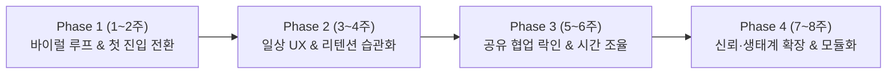

# 모아 캘린더(Moa Calendar) 성장 개선 리뷰 & 개발 플래닝

> **작성일**: 2026-11-23  
> **목표**: "잘 만든 개인 공유 캘린더"를 넘어 **사람들이 자발적으로 초대하고 매일 켜는 대중적 서비스**로 도약하기 위한 제품 리뷰 및 단계별 개발 실행 계획

---

## 1. 현황 진단

### 1.1 모아만의 핵심 강점 (계속 살려야 할 DNA)
- **체감 로딩 제로(Zero-Latency)**: 번들러 없이 정적 스켈레톤 HTML(`public/index.html`) + 캐시 복원으로 열자마자 달력이 뜨는 쾌적한 속도.
- **한국 생활 밀착 기본 기능**: 날씨 예보/강수확률·시간대별 모달, D-Day 위젯, 한국 음력/윤달, 글로벌 공휴일, 이달의 To-Do, 한글 자연 줄바꿈.
- **멀티플랫폼 기반**: Web/PWA, Android 네이티브 앱(홈 위젯 3종 포함), macOS 네이티브 앱(동적 날짜 Dock 아이콘, 네이티브 메뉴/상단 새로고침).
- **실시간 공유 인프라**: SSE 기반 실시간 동기화·접속 세션(Presence), 읽기 전용 일정 공유 링크(`/s/:token`) 및 방문자 통계, Google/iCloud 캘린더 연동, `../admin` 피드백 접수 연동 완료.

### 1.2 성장을 막고 있는 구조적 병목 (코드 기반 진단)
| 영역 | 현재 상태 (코드 기준) | 성장 저해 요인 |
| :--- | :--- | :--- |
| **바이럴 루프** | `schedule-shares.mjs`에 `og:image` 없음, 하단 텍스트 링크 1줄뿐, 초대 링크 동적 OG 미지원 | 카톡/문자 공유 시 썸네일이 비고, 받은 사람이 구경만 하고 이탈 |
| **첫 진입/전환** | `app.js` `renderLogin()`이 바로 로그인 벽 노출, 가입 직후 빈 화면(`empty-calendar`), 이메일 비밀번호 재설정/계정 삭제 미구현 | 서비스 체감 전 이탈, 첫날 빈 달력 경험, 이메일 가입 신뢰도 저하 |
| **일상 입력 UX** | 일정 추가 시 10개+ 필드 모달 진입 필수, 전용 장소 필드 없음, 다크 모드 미지원(`style.css`), `sw.js` 오프라인 캐싱 없음 | 매일 빠르게 기록하기 번거롭고, 지하철/야간 환경에서 메인 앱으로 쓰기 아쉬움 |
| **협업 락인** | 일정 CRUD·메모 중심(댓글/RSVP/작성자 표시/시간 조율 없음) | 공유는 되지만 소통을 위해 다시 카톡으로 이탈(TimeTree 대비 락인 약함) |
| **생태계/확장** | Google 읽기 전용 가져오기, 반복 일정 개별 복제 방식, `.ics` 구독 URL 없음, `app.js`(4,150줄)/`server.mjs`(1,200줄) 단일 파일 비대화 | 기존 구글/아이폰(iOS) 사용자 정착 마찰 및 기능 실험 속도 저하 위험 |

---

## 2. 목표 지표 (KPI & Funnel)

`../admin` 분석/이벤트 계측을 확장해 아래 핵심 퍼널을 추적합니다.

1. **유입 전환 (Visitor → Sign-up)**: 랜딩/공유 페이지 방문 대비 가입 완료율
2. **첫날 활성화 (Activation)**: 가입 후 24시간 내 첫 일정 1건 이상 생성 비율
3. **바이럴 계수 (Viral Loop)**: 활성 사용자 중 초대 링크(`/invite/*`) 또는 공유 링크(`/s/*`) 발급률 및 링크 클릭 대비 신규 가입 전환율
4. **핵심 정착 지표 (North Star)**: **2인 이상 함께 쓰는 활성 공유 캘린더 수 (Weekly Active Shared Calendars)**
5. **리텐션**: D1 / D7 / D30 재방문율 (아침 브리핑·위젯·푸시 오픈율 포함)

---

## 3. 개선 과제 우선순위 매트릭스

| 우선순위 | 과제 | 카테고리 | 기대 임팩트 | 예상 공수 | 배치 Phase |
| :---: | :--- | :--- | :---: | :---: | :---: |
| **P0** | 공유(`/s/:token`)·초대(`/invite/:token`) 동적 OG + CTA + 모바일 공유 시트 | 바이럴 | 매우 높음 | 낮음 (3~4일) | Phase 1 |
| **P0** | 무가입 인터랙티브 체험 + 가입 즉시 기본 캘린더/템플릿 온보딩 | 활성화 | 매우 높음 | 중간 (4~5일) | Phase 1 |
| **P0** | 핵심 퍼널 이벤트 계측 (`../admin` 연동) | 그로스 기반 | 높음 | 낮음 (1~2일) | Phase 1 |
| **P1** | 1줄 빠른 일정 입력(Quick Add) + 장소(지도 앱 연동) | 일상 UX | 매우 높음 | 중간 (5일) | Phase 2 |
| **P1** | 오늘의 아침 브리핑 푸시 (일정 + 날씨 + D-Day) | 리텐션 | 매우 높음 | 중간 (3~4일) | Phase 2 |
| **P1** | 다크 모드 + 오프라인 읽기 PWA (`sw.js`) | 완성도 | 높음 | 중간 (4~5일) | Phase 2 |
| **P1** | 일정별 참석(RSVP)·댓글/이모지 + 작성자/활동 피드 | 협업 락인 | 매우 높음 | 높음 (6~7일) | Phase 3 |
| **P2** | 빈 시간 겹쳐보기 & 약속 시간 투표 (Time Poll) | 바이럴/차별화 | 매우 높음 | 높음 (5~6일) | Phase 3 |
| **P2** | 이메일 비밀번호 재설정 + 회원 탈퇴(계정 삭제) | 신뢰/정책 | 높음 | 중간 (3~4일) | Phase 4 |
| **P2** | 반복 일정 시리즈 일괄 수정/삭제 (`series_id`) + 패턴 확장 | 파워 UX | 중간~높음 | 중간 (4~5일) | Phase 4 |
| **P2** | WebCal(`.ics`) 구독 URL + iOS 설치 가이드 + Google 양방향 동기화 | 생태계 | 높음 | 높음 (6~8일) | Phase 4 |
| **P3** | `app.js` / `server.mjs` 네이티브 ES Modules 점진 분리 | 유지보수 | 중간 | 중간 (지속) | Phase 2~4 병행 |

---

## 4. 단계별 개발 로드맵 (8주 플랜)

---

### Phase 1 (1~2주차): 바이럴 루프 & 첫 진입 전환 극대화

> **목표**: 링크를 받은 사람이 자연스럽게 가입하고, 가입한 사람이 1분 안에 첫 일정을 만들고 초대 링크를 보내도록 마찰 제거.

#### Workstream 1.1 — 공유·초대 바이럴 패키지
- **대상 파일**: `schedule-shares.mjs`, `server.mjs`, `public-pages.mjs`, `public/app.js`, `public/style.css`
- **상세 작업**:
  1. **동적 OG 메타 & 썸네일**:
     - `/s/:token`에 `og:image`, `twitter:card` 추가 (서버에서 SVG→PNG 또는 경량 OG 엔드포인트 `/api/og/share/:token` 제공, 캘린더/기간/일정 수 포함).
     - `/invite/:token` SSR HTML에 `"OO님이 '우리 가족' 캘린더에 초대했어요"` 동적 `og:title`·`og:description` 주입.
  2. **공유 페이지(`/s/:token`) 전환 CTA**:
     - 개별 일정 및 전체 기간 `.ics` 다운로드 버튼(`GET /s/:token/calendar.ics`) 추가.
     - 하단에 카드형 CTA 배치: **"내 모아 캘린더에 이 일정 복사하기"**, **"나도 10초 만에 내 일정 공유 링크 만들기"**.
  3. **모바일 네이티브 공유 & 카톡 인앱 대응**:
     - 초대/공유 모달에 `navigator.share` 버튼 추가(미지원 시 클립보드 복사 폴백).
     - `KAKAOTALK` 인앱 브라우저에서 Google OAuth 진입 시 외부 브라우저 열기 안내 배너 제공.
- **완료 기준(DoD)**:
  - 카톡/슬랙/iMessage에 `/s/:token`, `/invite/:token` 붙여넣기 시 제목·설명·이미지 카드 정상 표시.
  - `.ics` 다운로드 파일이 macOS 캘린더/iOS/Google 캘린더에서 오류 없이 열림.

#### Workstream 1.2 — 무가입 체험 & 첫날 온보딩
- **대상 파일**: `public/app.js`, `public/index.html`, `public/style.css`, `server.mjs`, `public/translations.js`
- **상세 작업**:
  1. **무가입 샌드박스 체험**:
     - 랜딩 화면(`renderLogin`)에 **"로그인 없이 먼저 둘러보기"** 버튼 추가.
     - 서버 계정 없이 클라이언트 메모리(localStorage)로 동작하는 샘플 캘린더(예시 일정 4~5건, 날씨, D-Day 포함) 제공 + 상단에 *"지금 저장하려면 3초 만에 로그인"* 배너 배치.
     - 로그인 시 체험 중 추가한 일정을 실제 첫 캘린더로 자동 이관.
  2. **가입 직후 기본 캘린더 자동 생성 & 용도 템플릿**:
     - 신규 회원 가입(`/auth/google`, `/auth/kakao`, `/auth/email/register`) 시 기본 `내 캘린더` 자동 생성(빈 화면 제거).
     - 최초 로그인 시 닫기 가능한 미니 온보딩 카드: `커플 캘린더 만들기` / `가족 캘린더 만들기` / `스터디·모임 만들기` 1클릭 생성 → 즉시 초대 링크 복사 연결.
- **완료 기준(DoD)**:
  - 신규 가입 후 빈 화면 없이 1초 내에 달력이 표시되고, 2클릭 이내에 공유 초대 링크 생성 가능.

#### Workstream 1.3 — 핵심 퍼널 계측
- **대상 파일**: `public/analytics.js`, `public/app.js`, `../admin` 분석 수집 API 확인
- **상세 작업**:
  - 비식별 이벤트 전송: `sandbox_start`, `signup_complete`, `first_event_created`, `invite_created`, `invite_accepted`, `share_link_created`, `share_cta_clicked`.
- **완료 기준(DoD)**:
  - `../admin`에서 퍼널 단계별 일일/주간 카운트 확인 가능.

---

### Phase 2 (3~4주차): 매일 쓰는 일상 UX & 리텐션 습관화 ✅ (구현 완료)

> **목표**: 기록 속도를 3배 빠르게 만들고, 매일 아침 알림과 다크 모드·오프라인 지원으로 "기본 캘린더" 신뢰 확보.

#### Workstream 2.1 — 1줄 빠른 일정 입력(Quick Add) + 장소(지도 앱 연동)
- **DB 마이그레이션**: `db/028_event_location.sql`
  - `ALTER TABLE events ADD COLUMN IF NOT EXISTS location text DEFAULT '';`
  - `ALTER TABLE events ADD COLUMN IF NOT EXISTS location_url text DEFAULT '';`
- **대상 파일**: `public/quick-add.js` (신규 ES 모듈), `public/app.js`, `public/index.html`, `public/style.css`, `server.mjs`, `ical.mjs`, `test/quick-add.test.mjs`
- **상세 작업**:
  1. **한국어/영어 자연어 파서 (`public/quick-add.js`)**:
     - 예: `"내일 오후 7시 강남역 저녁약속"`, `"금요일 14:30 치과"`, `"12/25 하루종일 크리스마스 #기념일"` → 날짜, 시작/종료 시간, 하루 종일, 카테고리 자동 추출 + 실시간 프리뷰 배지 표시.
     - 데스크톱 단축키(`Q` 또는 상단 빠른 입력 바) + 모바일 FAB 길게 누르기/빠른 입력 탭 지원.
  2. **장소 필드 & 지도 앱 원클릭 연동**:
     - 일정 모달 및 상세 아젠다에 `장소` 입력·표시 추가.
     - 장소 클릭 시 네이버지도(`nmap://` / 웹 폴백), 카카오맵, Google Maps 중 선택해 바로 길찾기 열기.
     - iCal(`.ics`/CalDAV) `LOCATION` 필드 양방향 매핑.
- **완료 기준(DoD)**:
  - 자연어 파서 단위 테스트 25+ 케이스 통과(한국어 상대 날짜, 오전/오후, 24시간제, 영어 날짜).
  - 키보드만으로 `Q` → 텍스트 입력 → `Enter`로 3초 내 일정 생성 완료.

#### Workstream 2.2 — 오늘의 아침 브리핑 푸시
- **DB 마이그레이션**: `db/029_daily_briefing_preferences.sql`
  - `daily_briefing_enabled boolean NOT NULL DEFAULT false`
  - `daily_briefing_time text NOT NULL DEFAULT '08:00'` (HH:MM, KST/사용자 타임존)
  - `briefing_weather_lat / briefing_weather_lon / briefing_location_name`
  - `last_briefing_sent_date date` (중복 발송 방지)
- **대상 파일**: `push-notifications.mjs`, `server.mjs`, `public/index.html`, `public/app.js`, `test/push-notifications.test.mjs`
- **상세 작업**:
  1. 설정 > 알림 설정에 **"매일 아침 일정·날씨 브리핑 받기"** 토글 및 시간 선택(06:00~10:00) 추가.
  2. 서버 백그라운드 스케줄러(매분 체크)에서 대상 사용자 조회 → 오늘 일정 수/첫 일정 + 날씨/강수확률 + 가장 가까운 D-Day를 조합해 Web Push / Android / macOS 브리핑 발송.
  3. `last_briefing_sent_date` 원자적 업데이트로 PM2 재시작 시에도 중복 발송 차단.
- **완료 기준(DoD)**:
  - 테스트 브리핑 즉시 발송 기능 동작 + 중복 발송 방지 단위 테스트 통과.

#### Workstream 2.3 — 다크 모드 & 오프라인 읽기 PWA
- **대상 파일**: `public/style.css`, `public/app.js`, `public/index.html`, `public/sw.js`, `public/manifest.webmanifest`
- **상세 작업**:
  1. **시맨틱 CSS 변수화 & 다크 모드**:
     - `:root` 색상을 `--bg-page`, `--bg-surface`, `--bg-subtle`, `--text-primary`, `--text-muted`, `--border`, `--accent` 등으로 정리하고 `color-scheme: light dark` 적용.
     - 설정(언어 및 지역/화면 표시)에 `시스템 설정 / 라이트 / 다크` 3단 선택 제공(초기 깜빡임 방지를 위해 `locale.js` 최상단에서 `data-theme` 즉시 적용).
     - `macos/Sources/MainWindowController.swift` 및 Android WebView 배경색 동기화.
  2. **오프라인 읽기 PWA (`public/sw.js`)**:
     - 정적 에셋(HTML 스켈레톤, CSS, JS, 아이콘)에 `Stale-While-Revalidate` 캐시 전략 적용.
     - 최근 조회한 캘린더 목록·월간 일정·메모를 `IndexedDB`(또는 Cache API)에 저장해 오프라인 시 읽기 전용 배지(`오프라인 모드 · 마지막 동기화 HH:MM`)와 함께 정상 렌더링.
- **완료 기준(DoD)**:
  - DevTools Offline 상태에서 새로고침해도 달력과 최근 일정이 깨지지 않고 표시됨.
  - 다크 모드에서 12색 일정 필·공휴일·날씨 배지 모두 WCAG AA 대비 충족.

---

### Phase 3 (5~6주차): 공유 캘린더만의 협업 락인 ✅ (구현 완료)

> **목표**: "일정 확인 → 소통 → 시간 합의"가 모아 안에서 완결되도록 만들어 공유 그룹의 이탈 방지.

#### Workstream 3.1 — 일정별 RSVP(참석 여부) · 댓글/이모지 · 작성자 표시
- **DB 마이그레이션**: `db/030_event_collaboration.sql`
  - `events`: `created_by text`, `updated_by text` 컬럼 추가(기존 일정은 NULL 허용).
  - `event_rsvps (event_id, user_id, status ['going'|'maybe'|'declined'], updated_at, PRIMARY KEY(event_id, user_id))`
  - `event_comments (id, event_id, calendar_id, user_id, body, created_at, deleted_at)`
  - `event_reactions (event_id, user_id, emoji, created_at, PRIMARY KEY(event_id, user_id, emoji))`
- **대상 파일**: `server.mjs`, `public/app.js`, `public/index.html`, `public/style.css`, `push-notifications.mjs`, `test/event-collaboration.test.mjs`
- **상세 작업**:
  1. **API 엔드포인트**:
     - `PUT /api/events/:id/rsvp` (참석/미정/불참 토글)
     - `GET / POST / DELETE /api/events/:id/comments`
     - `POST / DELETE /api/events/:id/reactions`
  2. **실시간 반영 & 푸시**:
     - RSVP/댓글 변경 시 기존 SSE `broadcast(calendarId, 'event-collab', { eventId })`로 열려 있는 멤버에게 즉시 반영.
     - 댓글 등록 시 해당 캘린더 다른 멤버에게 Web Push 알림(알림 설정에서 끄기 가능).
  3. **UI**:
     - 공유 캘린더(멤버 2인 이상)의 일정 상세 하단에 RSVP 3버튼, 참여자 칩, 간단 댓글 스레드 및 작성자 배지 노출(1인 개인 캘린더에서는 깔끔하게 숨김 처리해 복잡도 증가 방지).

#### Workstream 3.2 — 공유 캘린더 활동 피드
- **DB/API**: 기존 `events`/`event_comments` 타임스탬프 또는 경량 `calendar_activities` 테이블로 최근 30건 조회(`GET /api/calendars/:id/activities`).
- **UI**: 우측 패널(모바일은 상단/알림 시트)에 최근 변경 요약("지민님이 '부산 여행'에 댓글을 남겼어요 · 5분 전") 표시 및 클릭 시 해당 일정으로 바로 이동.

#### Workstream 3.3 — 빈 시간 겹쳐보기 & 약속 시간 투표 (Time Poll)
- **DB 마이그레이션**: `db/031_schedule_polls.sql`
  - `schedule_polls (id, calendar_id, creator_id, title, location, duration_minutes, status, token, created_at, expires_at)`
  - `schedule_poll_options (id, poll_id, start_time, end_time)`
  - `schedule_poll_votes (option_id, voter_key, voter_name, user_id, availability ['yes'|'maybe'], created_at)`
- **상세 작업**:
  1. **빈 시간 겹쳐보기**: 여러 캘린더 선택 시 주간 뷰에서 겹치는 바쁜 시간대를 반투명 마스크로 표시해 빈 시간 한눈에 파악.
  2. **약속 투표 링크 (`/poll/:token`)**:
     - 캘린더에서 후보 시간 2~5개를 클릭해 투표 링크 생성 → **비로그인 참여자도 이름만 입력하고 가능한 시간 체크**.
     - 최다 득표 시간에서 **"이 시간으로 일정 확정"** 1클릭 → 공유 캘린더 일정 자동 생성 + 투표 참여자에게 모아 가입 유도 CTA 노출.
- **완료 기준(DoD)**:
  - 투표 생성 → 비로그인 참여자 투표 → 일정 확정 E2E 테스트 통과.

---

### Phase 4 (7~8주차): 신뢰·생태계 확장 & 아키텍처 정비 ✅ (구현 완료)

> **목표**: 스토어 심사/보안 신뢰를 완비하고, iOS·Google 생태계와의 벽을 허물며 장기 유지보수성 확보.

#### Workstream 4.1 — 계정 기본기 & 스토어 정책 대응
- **대상 파일**: `server.mjs`, `local-auth.mjs`, `public/app.js`, `public/index.html`, `test/auth-account.test.mjs`
- **상세 작업**:
  1. **비밀번호 재설정**: `POST /auth/email/forgot`, `POST /auth/email/reset` (1회용 토큰, 만료 30분, 이메일 발송 연동) 및 이메일 비밀번호 최소 길이 정책 재검토(8자 이상 + 일반 취약 비밀번호 차단).
  2. **회원 탈퇴(계정 삭제)**: 설정 > 계정 및 프로필에 `계정 삭제` 플로우 추가(`DELETE /api/me`). 단독 소유 캘린더 삭제/위임 안내 후 세션·토큰·개인 데이터 영구 삭제 (Google Play / App Store 필수 요건).

#### Workstream 4.2 — 반복 일정 시리즈 관리 & 패턴 확장
- **DB 마이그레이션**: `db/032_event_series.sql`
  - `events.series_id uuid`, `events.recurrence_rule jsonb` 추가.
- **상세 작업**:
  - 반복 생성 시 `series_id` 부여, 수정/삭제 시 **"이 일정만 / 이후 모든 일정"** 선택 다이얼로그 제공.
  - 반복 패턴 추가: `평일(월~금)`, `격주`, `매월 마지막 날`.

#### Workstream 4.3 — 생태계 확장 (`.ics` 구독 + iOS UX + Google 양방향)
- **상세 작업**:
  1. **WebCal(`.ics`) 읽기 전용 구독 URL**: 캘린더 관리에서 비밀 토큰 기반 `webcal://dwm.brightnetworks.kr/ical/:token.ics` 발급·재발급. iOS 기본 캘린더·Outlook·macOS 캘린더에서 실시간 구독 가능.
  2. **iOS PWA 가이드 & Apple 로그인 검토**: Safari 사용자 대상 홈 화면 추가 안내 카드 보강.
  3. **Google 캘린더 양방향 동기화**: 기존 iCloud CalDAV 동기화 패턴(`caldav-sync.mjs`)을 참고해 Google Calendar `syncToken` 기반 증분 동기화 및 편집 반영 구현(Google OAuth 스코프 재심사 일정 고려해 피처 플래그로 단계 배포).

#### Workstream 4.4 — 코드베이스 점진 모듈화 (Phase 2~4 병행)
- **원칙**: Zero-bundler / Native ES Modules 철학 유지.
- **분리 대상**:
  - `public/app.js` → `public/modules/` (`state.js`, `api.js`, `quick-add.js`, `event-dialog.js`, `collab.js`, `settings.js`, `theme.js`)
  - `server.mjs` → `routes/` (`auth.mjs`, `calendars.mjs`, `events.mjs`, `shares.mjs`, `feedback.mjs`, `polls.mjs`)
- **규칙**: 기능 추가 시 새 기능부터 모듈로 분리하고, 기존 코드는 건드리는 영역만 점진 이동해 회귀 위험 최소화.

---

## 5. 주요 리스크 및 사전 의사결정 포인트

| 리스크 / 결정 사항 | 내용 | 대응 방안 |
| :--- | :--- | :--- |
| **이메일 발송 인프라** | 비밀번호 재설정(Phase 4.1)에 트랜잭션 메일 발송 필요 | Cloudflare Email Service / Resend / SMTP 중 기존 `../admin` 발송 설정(`admin-notification.ts`) 재사용 여부 결정 |
| **카카오 인앱 OAuth 제한** | 카카오톡 인앱 브라우저에서 Google OAuth가 차단됨 | Phase 1.1에서 인앱 감지 시 카카오 로그인 우선 강조 + `kakaotalk://web/openExternal` 외부 브라우저 열기 버튼 제공 |
| **Google 양방향 동기화 심사** | 읽기 전용에서 쓰기 스코프(`calendar.events`) 확장 시 Google OAuth 재검증 필요 | Phase 4.3은 `.ics` 구독 URL을 먼저 출시해 즉시 효용을 주고, Google 쓰기 스코프는 별도 심사 트랙으로 진행 |
| **단일 프로세스 메모리/스케줄러** | 아침 브리핑 + SSE 연결 증가 시 부하 관리 필요 | 브리핑은 DB 배치 조회(`LIMIT 100`) + `last_briefing_sent_date` 락으로 안전하게 분산 발송 |
| **1인 사용자 UI 복잡도 증가** | 댓글/RSVP/투표가 개인 캘린더까지 어지럽힐 수 있음 | 협업 UI는 **멤버 2인 이상 공유 캘린더에서만 자동 노출**하는 점진적 공개(Progressive Disclosure) 원칙 적용 |

---

## 6. 즉시 시작 가능한 첫 스프린트 체크리스트 (Week 1)

- [x] **Task 1**: `/s/:token`에 동적 OG 메타(`og:image` 포함), `.ics` 내보내기(`/s/:token/calendar.ics`), 하단 전환 CTA 카드 및 모아 복사(`/api/schedule-shares/:token/import`) 추가
- [x] **Task 2**: `/invite/:token` SSR 동적 OG 프리뷰("OO님이 '캘린더명'에 초대했어요") 구현
- [x] **Task 3**: 모바일 초대/공유 모달에 `navigator.share` 버튼 및 카톡 인앱 브라우저 안내 추가
- [x] **Task 4**: `renderLogin()`에 무가입 인터랙티브 체험(샘플 캘린더 + 로그인 시 자동 이관) + 신규 가입 시 기본 `내 캘린더` 자동 생성 및 템플릿 온보딩 적용
- [x] **Task 5**: 핵심 퍼널 이벤트 계측(`POST /api/analytics/event` + `window.MoaAnalytics.track`) 연결 및 단위/통합 테스트 추가 (`test/phase1-growth.test.mjs`)
